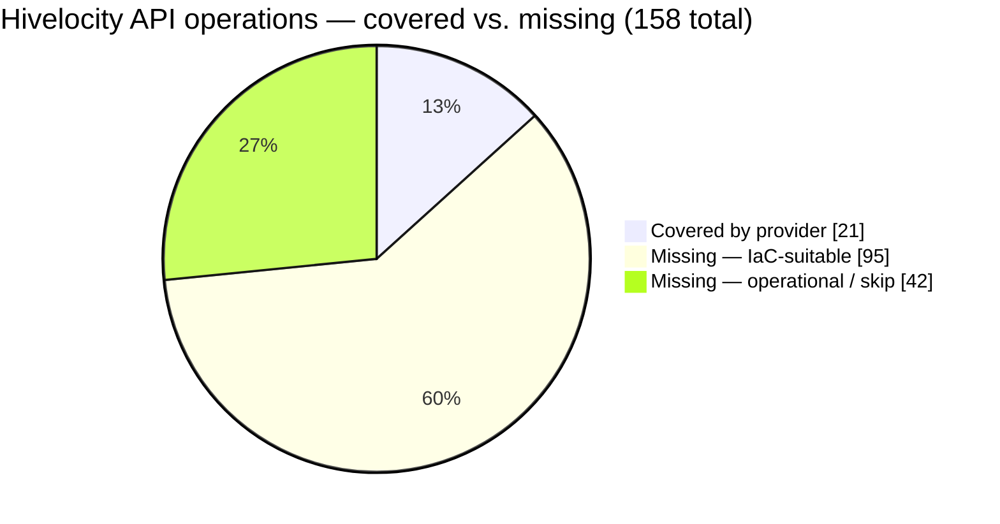
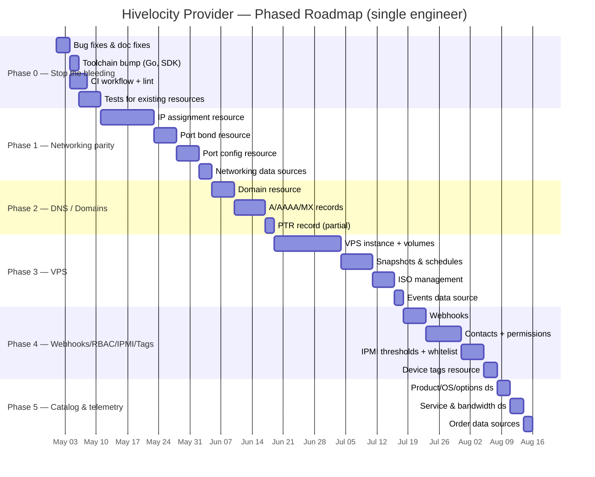
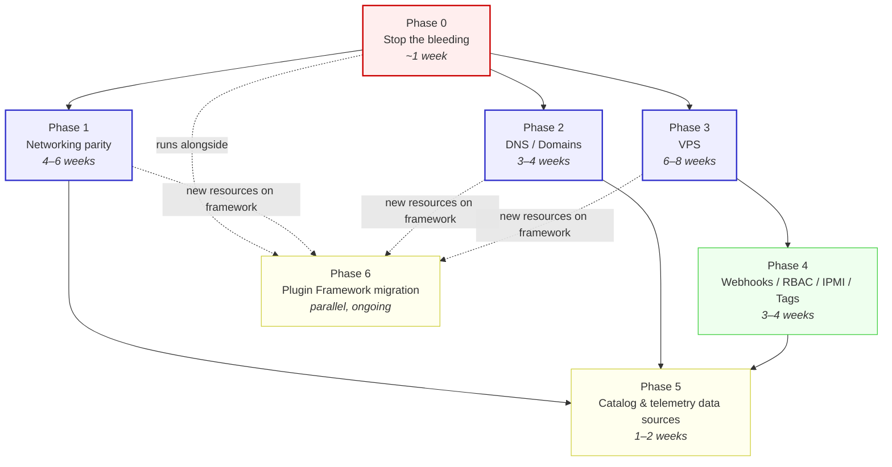

# Hivelocity Terraform Provider — Upgrade Plan

> **Status (2026-10-28):** Phases 0–5 implemented on the `api-refresh` branch (26 resources, 34 data sources);
> Phase 6 (Plugin Framework migration) deliberately not started. The new resources have not yet been
> exercised against a live account — see the PR description for what still needs acceptance testing.
> **Spec source of truth:** [`swagger.json`](./swagger.json) — OpenAPI 2.0, now 136 paths, 153 definitions, 27 tag groups
> **Provider before this work:** 5 resources, 7 active data sources (1 disabled), most files unchanged since Dec 2022 / Aug 2023

The analysis below describes the state of the provider *before* the refresh and is kept for context.
Still intentionally unmodelled after the refresh: billing info, bandwidth graphs, the `/deploy` cart
workflow, `/account/controlled-client`, IPMI whitelist/thresholds, private cloud, rapid restore, Veeam
backup status, VPS metrics/console/password reset, and `POST /ip` (which opens a support ticket rather
than returning an assignment).

This is the top-level overview. Detail lives in `upgrade_plan/`:

- [`01-current-state.md`](./upgrade_plan/01-current-state.md) — what the provider implements today
- [`02-gap-analysis.md`](./upgrade_plan/02-gap-analysis.md) — what's missing vs. the API, classified by IaC suitability
- [`03-code-quality.md`](./upgrade_plan/03-code-quality.md) — bugs, stale code, modernization items
- [`04-roadmap.md`](./upgrade_plan/04-roadmap.md) — phased plan with effort sizing, dependencies, and timeline

---

## TL;DR

The Hivelocity API has grown well beyond what the Terraform provider exposes. Of the API's 158 operations, only ~21 are wired into Terraform. Entire major surfaces — **VPS, DNS/Domains, IP assignments, webhooks, port bonding, IPMI, contacts/RBAC** — have zero coverage. The provider's networking story in particular is thin: VLAN CRUD exists, but IP assignment, port bonding, and per-port network config are all absent.

Beyond the missing surface area, there are a handful of immediate bugs and modernization items (debug `fmt.Println` left in production, doc/example mismatches, a disabled-but-implemented data source, a 16-month-old toolchain) that should be fixed before adding new resources.

Estimated effort to reach API parity: **~5–6 months of single-engineer work**, split into six phases. Phase 0 (stop-the-bleeding) is mandatory and small; Phases 1–3 (networking, DNS, VPS) are the high-value bulk; Phases 4–5 round out feature completeness.

---

## API coverage at a glance

```mermaid
%%{init: {'theme':'default'}}%%
xychart-beta
    title "Operations per API tag — covered vs missing"
    x-axis ["Device","Domains","VPS","IPAssignment","Contact","Webhook","BareMetal","Deploy","VLAN","Ignition","OrderGroup","SshKey","Bandwidth","Permission","Account","Billing","Network","Order","Product","Service","Inventory"]
    y-axis "Operations" 0 --> 30
    bar [3, 0, 0, 0, 0, 0, 6, 0, 6, 5, 5, 5, 0, 0, 0, 0, 1, 0, 0, 0, 1]
    bar [26, 22, 22, 9, 8, 7, 0, 6, 0, 0, 0, 0, 4, 4, 3, 3, 2, 3, 3, 3, 1]
```

The first bar series is **covered**; the second is **missing**. Three tags are fully covered today (SshKey, Ignition, OrderGroup) plus partial coverage of Bare Metal Devices, VLAN, Device, Inventory, and Network.

---

## Roadmap timeline

The exact dates are illustrative — what matters is the relative durations and dependencies. Phase 6 (Plugin Framework migration) runs in parallel to all of the above and is described in [`04-roadmap.md`](./upgrade_plan/04-roadmap.md).

---

## Phase dependency graph

Phases 1, 2, and 3 can in principle run in parallel after Phase 0 — they touch independent parts of the codebase. The serial ordering above assumes a single engineer; with two engineers Phase 2 and Phase 3 can run alongside Phase 1.

---

## Open questions for stakeholders

These should be answered before locking the roadmap. Full discussion in [`04-roadmap.md`](./upgrade_plan/04-roadmap.md#open-questions).

1. **`/deploy/*` vs `/bare-metal-devices`** — is `/deploy/*` still primary or fully superseded?
2. **VPS create flow** — the spec only shows `GET/PUT/DELETE /vps/{id}`; where does VPS provisioning POST live?
3. **DNS record-type gap** — will the API gain CNAME/TXT/SRV/NS support? Affects whether Phase 2 ships in one stage or two.
4. **Plugin Framework migration appetite** — comfortable with `terraform-plugin-mux` + gradual migration, or stay fully on SDKv2?
5. **CI sandbox account** — is there a billable-but-bounded test account for `TF_ACC=1` runs in CI?

---

## How to read the rest of this plan

If you only have time for one file, read [`02-gap-analysis.md`](./upgrade_plan/02-gap-analysis.md) — that's the map of every missing surface, classified by priority and IaC suitability. If you're scoping work, read [`04-roadmap.md`](./upgrade_plan/04-roadmap.md). If you want to know what's broken right now, read [`03-code-quality.md`](./upgrade_plan/03-code-quality.md).
