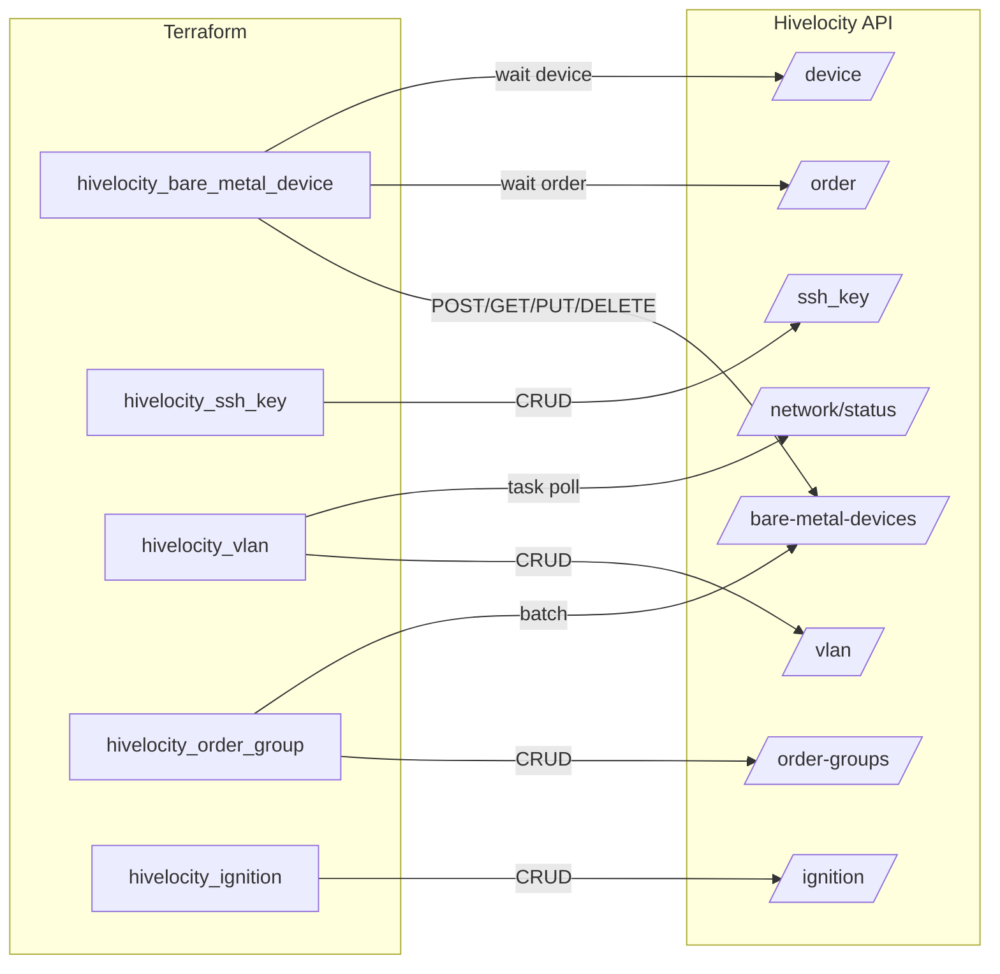
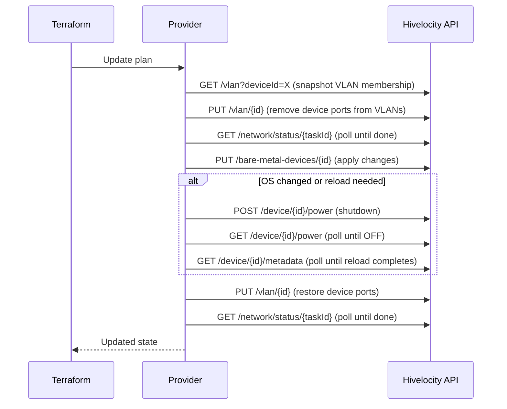

# 01 — Current State

What the provider implements today, as of analysis date 2026-04-25.

- **Provider source:** `hivelocity/` directory, ~80 KB of Go
- **SDK:** `hivelocity-client-go` (auto-generated from `swagger.json`), vendored via `replace` in `go.mod:68`
- **Terraform Plugin SDK:** v2.17.0 (current upstream is v2.36+)
- **Go toolchain:** 1.18 (current LTS-equivalent is 1.22+)
- **Most recent meaningful changes:** Aug 2023 (sp-299 product source, referer header)

---

## Provider configuration

`hivelocity/provider.go` + `hivelocity/config.go`

| Field | Type | Required | Env var | Notes |
|---|---|---|---|---|
| `api_key` | String, Sensitive | Yes | `HIVELOCITY_API_KEY` | OAuth2 flavor — sent as `X-API-KEY` header |
| `api_url` | String | Yes (with default) | `HIVELOCITY_API_URL` | Defaults to `https://core.hivelocity.net/api/v2`. **Bug:** `Required: true` + default is contradictory; should be `Optional: true` |

Every request also carries `Referer: Terraform` (added in `config.go`).

---

## Resources (5)



### `hivelocity_bare_metal_device`

`hivelocity/resource_bare_metal_device.go` (303 lines)

| Attribute | Type | Mode |
|---|---|---|
| `device_id`, `order_id`, `service_id` | int | Computed |
| `product_id` | int | **Required**, ForceNew |
| `os_name`, `location_name`, `hostname` | string | **Required** |
| `tags`, `script`, `public_ssh_key_id`, `ignition_id` | various | Optional |
| `bonded` | bool | Optional, ForceNew |
| `vlan_id` | int | Optional, **Deprecated** — use `hivelocity_vlan` instead (`resource_bare_metal_device.go:91`) |
| `force_device_id` | int | Optional (internal use) |
| `power_status`, `primary_ip`, `period`, `product_name`, `last_updated` | various | Computed |

**CRUD:** all four operations. The update path is unusually heavy — it removes the device from any VLANs, may power-cycle the device, waits for reload, then restores VLAN membership (`helpers_resource_device.go:495-568`).

**Update flow:**



**Known issues:**
- Tainted-device retry comment at `resource_bare_metal_device.go:200` notes the workaround "does not work at the moment because device statuses being inaccessible for new devices."
- `vlan_id` field is marked deprecated but still functional.

### `hivelocity_ssh_key`

`hivelocity/resource_ssh_key.go` — full CRUD against `/ssh_key`. Fields: `name`, `public_key`, `ssh_key_id` (computed). Simple and clean; good template for new simple resources.

### `hivelocity_vlan`

`hivelocity/resource_vlan.go` (295 lines) — full CRUD against `/vlan` with async task polling against `/network/status/{taskId}`. Fields: `facility_code` (ForceNew), `type` (ForceNew, "private"|"public"), `port_ids` (set of ints), `tag_id` (computed).

The async-task pattern here is reusable — copy it for any future endpoint that returns a task ID (IP routing, port config).

### `hivelocity_order_group`

`hivelocity/resource_order_group.go` (299 lines) — full CRUD against `/order-groups` plus batch device creation via `POST /bare-metal-devices/batch`. Manages a nested list of `bare_metal_device` blocks; tracks adds/updates/deletes by device ID across plan runs. Has a `CustomizeDiff` hook (`resourceOrderGroupDiff`) that forces new on location/product change.

### `hivelocity_ignition`

`hivelocity/resource_ignition_config.go` — full CRUD against `/ignition`. Validates JSON content on input and normalizes via `normalizeJsonString()` to keep diffs clean.

---

## Data sources (7 active, 1 disabled)

| Terraform name | API endpoint | File | Notes |
|---|---|---|---|
| `hivelocity_bare_metal_device` | `GET /bare-metal-devices` | `data_source_bare_metal_device.go` | Filterable |
| `hivelocity_device` | `GET /device` | `data_source_device.go` | Filterable; different schema than bare_metal_device |
| `hivelocity_product` | `GET /inventory/product` | `data_source_product.go` | **Bypasses SDK, uses raw `net/http`**; debug `fmt.Println` left in (lines 83-84) |
| `hivelocity_ssh_key` | `GET /ssh_key` | `data_source_ssh_key.go` | Filterable |
| `hivelocity_device_initial_creds` | `GET /device/{id}/initial-creds` | `data_source_device_initial_creds.go` | Direct lookup |
| `hivelocity_effective_ignition` | `GET /device/{id}/ignition` | `data_source_effective_ignition.go` | Direct lookup |
| `hivelocity_device_port` | `GET /device/{id}/ports` | `data_source_port.go` | Smart default filter (bonds first, then private/eth1) |
| ~~`hivelocity_ignition`~~ | `GET /ignition` | `data_source_ignition_config.go` | **Implementation complete but commented out at `provider.go:36`** |

---

## Helpers and shared code

- **`filters.go`** (166 lines) — generic data-source filter implementation (`filter { name = ... values = [...] }` block). Has a TODO at line 48: validate filter names against the schema instead of silently producing no-match errors.
- **`helpers_datasources.go`** (86 lines) — CamelCase ↔ snake_case key conversion, JSON normalization, schema-key filtering for API responses.
- **`helpers_resource_device.go`** (607 lines) — order/device/power waiters, VLAN snapshot/restore, batch create, formatted error wrapper. The complexity here is genuinely required by the API's async behavior.

---

## Tests

One acceptance test exists: `resource_vlan_test.go` (`TestAccHivelocityVlan_basic`). It uses hard-coded test data (line 22 has a comment acknowledging this isn't ideal) driven by env vars `HIVELOCITY_TEST_FACILITY_CODE` and `HIVELOCITY_TEST_PORT_ID`.

No tests for: `bare_metal_device`, `ssh_key`, `order_group`, `ignition`, or any data source. No unit tests for `filters.go` or `helpers_datasources.go`.

No CI workflow exists in `.github/` — only `dependabot.yml`. `.goreleaser.yml` exists but isn't tied to release automation.

---

## Documentation and examples

```
docs/
├── index.md                       # provider overview (has VLAN example bug — uses device_ids)
├── data-sources/                  # 7 .md files
│   ├── bare_metal_device.md
│   ├── device.md
│   ├── device_initial_creds.md
│   ├── device_port.md
│   ├── effective_ignition.md
│   ├── product.md
│   └── ssh_key.md
└── resources/                     # 5 .md files
    ├── bare_metal_device.md
    ├── ignition.md
    ├── order_group.md
    ├── ssh_key.md
    └── vlan.md

examples/
├── data-sources/                  # 6 dirs (note: ignition_config example exists, ds is disabled)
└── resources/                     # 5 dirs
```

**Doc/code mismatches:**
1. `docs/index.md:73-76` and `README.md:88-94` — VLAN example uses `device_ids` but the schema field is `port_ids`.
2. `examples/data-sources/hivelocity_ignition_config/` exists but the data source is commented out in `provider.go:36`.
3. No docs file for the disabled `hivelocity_ignition` data source.
