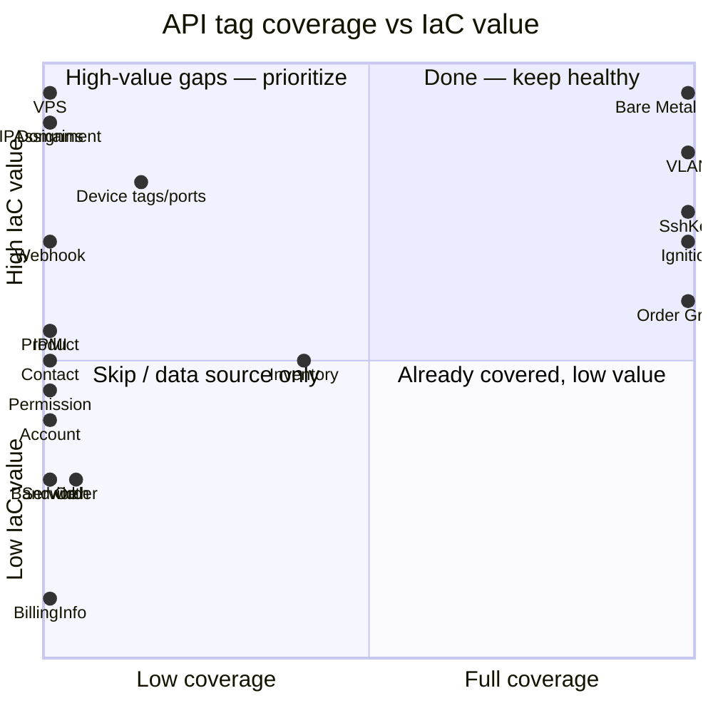
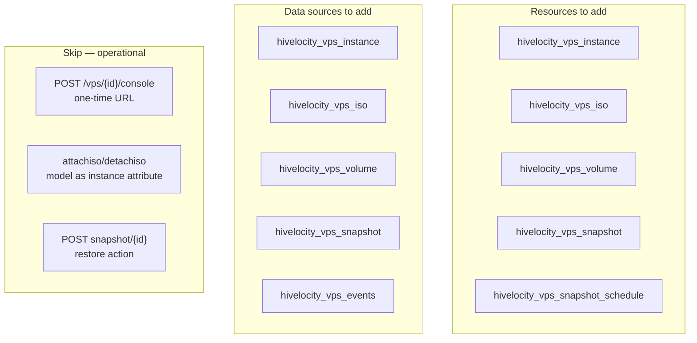
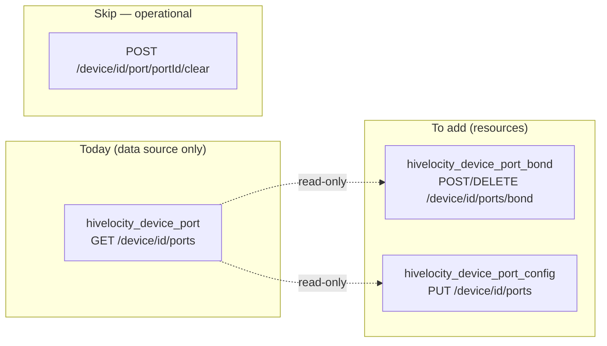
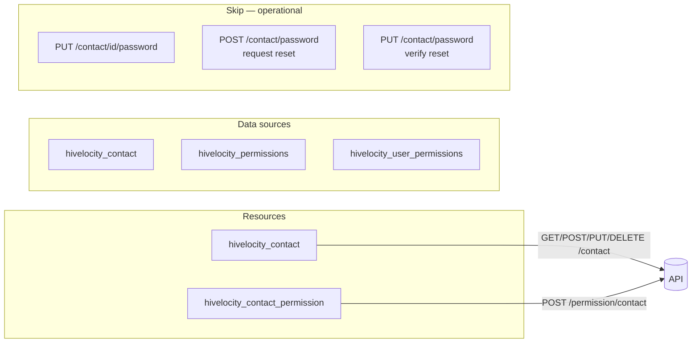

# 02 — Gap Analysis

Every API surface the provider does not currently expose, classified by IaC suitability.

**Legend:**
- ✅ **IaC-suitable** — declarative, belongs in Terraform as a resource
- 📖 **Read-only** — only meaningful as a data source
- ⚙️ **Operational** — one-shot or runtime concern, skip
- ❌ **Not applicable** — billing, password reset, etc.

The swagger spec contains **0 endpoints marked deprecated**, so nothing currently in the provider is removed from the API. All gaps are *additions* the API has that the provider does not expose.

---

## Coverage map by tag

The top-right ("done") shows the provider's current strengths. The top-left is where the bulk of new work lives. The bottom rows are lower-priority data sources or skip-altogether.

---

## ✅ HIGH-priority gaps (IaC-suitable, large)

### VPS — entire surface missing (22 ops)

**Open question:** the spec only shows `GET/PUT/DELETE /vps/{id}` — no POST for create. Verify with API team before sizing this work; create likely flows through `/bare-metal-devices` provisioning.

### DNS / Domains — entire surface missing (22 ops)

| Resource | Endpoints | Notes |
|---|---|---|
| `hivelocity_domain` | `GET/POST/DELETE /domains[/{id}]` | No PUT in spec — domain attrs are immutable |
| `hivelocity_dns_a_record` | full CRUD on `/domains/{domain}/a-record/*` | |
| `hivelocity_dns_aaaa_record` | full CRUD on `/domains/{id}/aaaa-record/*` | |
| `hivelocity_dns_mx_record` | full CRUD on `/domains/{id}/mx-record/*` | |
| `hivelocity_dns_ptr_record` | `GET/PUT /domains/ptr[/{id}]` | **Partial CRUD only** — no POST/DELETE in API |

**API gap to flag with Hivelocity:** no CNAME, TXT, SRV, or NS record support. That's a real DNS-API gap, not a provider gap.

### IP Assignments — entire surface missing (9 ops)

| Resource / data source | Endpoints | Notes |
|---|---|---|
| `hivelocity_ip_assignment` (resource) | `GET/POST/PUT/DELETE /ip[/{id}]` | PUT routes assignment to a device |
| `hivelocity_ip_assignment` (data source) | `GET /ip/{id}`, `GET /ip/address/{ip}` | Lookup by ID or IP |
| `hivelocity_ip_assignment_split` | `POST /ip/{id}/split` | Produces multiple smaller assignments |
| `hivelocity_ip_assignment_combine` | `POST /ip/combine` | Mutates other resources — model as null_resource or skip |
| ⚙️ skip | `POST /ip/{id}/clear` | Operational reset |

### Port Bonding & Configuration — partial today (5 device ops)

The provider can *read* ports today (`hivelocity_device_port` data source) but not configure them.

### Webhooks — entire surface missing (7 ops)

| Resource / data source | Endpoints |
|---|---|
| `hivelocity_webhook` resource | `GET/POST/PUT/DELETE /webhooks[/{id}]` |
| `hivelocity_webhook_events` data source | `GET /webhooks/events` (catalog of trigger events) |
| ⚙️ skip | `POST /webhooks/trigger` (manual fire — runtime action) |

---

## ✅ MEDIUM-priority gaps (IaC-suitable, smaller)

### Device tagging (5 ops)

| Item | Endpoint | Notes |
|---|---|---|
| `hivelocity_device_tags` resource | `GET/PUT /device/{id}/tags` | Tags are settable today via `bare_metal_device.tags`, but a standalone resource enables tagging imported/pre-existing devices and avoids drift fights |
| `hivelocity_device_tags` data source | `GET /device/tags` | List all tags in account |
| ⚙️ skip | `GET/PUT /device/tags-order`, `GET /device/tags-order/all` | UI ordering — debatable IaC value |

### Contacts / RBAC (8 + 4 ops)

### IPMI configuration (8 ops, mostly read)

| Item | Endpoint | Type |
|---|---|---|
| `hivelocity_device_ipmi_thresholds` resource | `GET/PUT /device/{id}/ipmi/thresholds` | ✅ |
| `hivelocity_device_ipmi_thresholds_bulk` resource | `PUT /device/ipmi/thresholds` | ✅ |
| `hivelocity_device_ipmi_whitelist` resource | `POST /device/{id}/ipmi/whitelist/` | ✅ verify DELETE/clear semantics |
| `hivelocity_device_ipmi` data source | `GET /device/{id}/ipmi` | 📖 |
| `hivelocity_device_ipmi_login` data source | `GET /device/{id}/ipmi/login-data` | 📖 |
| `hivelocity_device_ipmi_valid_login` data source | `GET /device/{id}/ipmi/valid-login` | 📖 |
| `GET /device/{id}/ipmi/nat` | clears whitelist | ⚙️ skip — operational |

### Account / Enterprise (3 ops)

| Resource | Endpoint | Notes |
|---|---|---|
| `hivelocity_controlled_client` | `GET/POST/PUT /account/controlled-client` | PUT deactivates; no DELETE in spec |

---

## 📖 Data-source-only additions

### Service info (3 ops)

- `hivelocity_service` — `GET /service/{id}`
- `hivelocity_services` — `GET /service/`
- `hivelocity_service_types` — `GET /service/types`
- `hivelocity_device_services` — `GET /device/{id}/services`

### Product metadata (3 ops, today only `/inventory/product` is exposed)

- `hivelocity_product_options` — `GET /product/{id}/options` and `GET /product/options`
- `hivelocity_product_operating_systems` — `GET /product/{id}/operating-systems` (**high user value** — today users guess `os_name` strings)
- `hivelocity_inventory_product` (per-id) — `GET /inventory/product/{id}` (today only the list endpoint is wrapped)

### Bandwidth telemetry

- `hivelocity_bandwidth_device` — `POST /bandwidth/device/{id}` (POST despite being read; payload carries time range)
- `hivelocity_bandwidth_service` — `POST /bandwidth/service/{id}`
- ⚙️ skip — `*/image` PNG-rendering endpoints

### Orders

- `hivelocity_order` — `GET /order/{id}`
- `hivelocity_orders` — `GET /order/` (filterable)
- ⚙️ skip — `GET /order/in-progress` (runtime view)

### Device state queries

- `hivelocity_device_power` — `GET /device/{id}/power`
- `hivelocity_device_ips` — `GET /device/{id}/ips`

---

## ⚙️ Endpoints to skip (intentional)

| Endpoint | Why skip |
|---|---|
| Billing Info (3 ops, all of `/billing-info/`) | PCI-sensitive operational concern |
| Bandwidth `*/image` endpoints | PNG generation, not IaC |
| Network task status (3 ops, `/network/status/*`) | Used internally by the provider for async waits, not user-facing |
| `POST /device/{id}/power` | Imperative reboot/shutdown — would fight reality on every plan. Model as a `null_resource` provisioner if needed at all |
| `POST /vps/{id}/console` | One-time URL |
| `POST /webhooks/trigger` | Manual fire |
| `POST /vps/snapshot/{id}` | Restore action — operational |
| `POST /ip/{id}/clear`, `POST /device/{id}/port/{portId}/clear`, `DELETE /device/{id}/ports/bond` (as standalone), `GET /device/{id}/ipmi/nat` | Imperative resets / clears |
| `PUT /contact/{id}/password`, `POST/PUT /contact/password` | Password reset flows |

---

## ❓ Endpoints to verify with Hivelocity API team

| Surface | Question |
|---|---|
| Deployment workflow (`/deploy/*`, 6 ops) | Multi-step billing-tied workflow that overlaps with `/bare-metal-devices` provisioning. Is `/deploy/*` still primary or fully superseded? |
| VPS create | Spec only shows `GET/PUT/DELETE /vps/{id}`. Where does VPS provisioning POST live? `/bare-metal-devices` shared infrastructure? |
| DNS record types | Will the API gain CNAME/TXT/SRV/NS support? Affects whether DNS phase ships in one stage or two |
| PTR records | API has no POST/DELETE — confirm this is intentional (typically PTR is auto-created with the IP assignment) |
| IPMI whitelist | What's the DELETE/clear semantics? Spec only shows POST to add |
