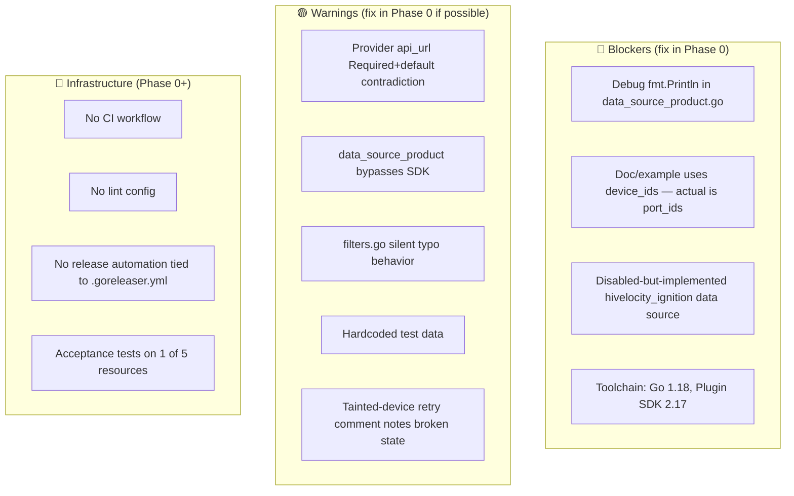
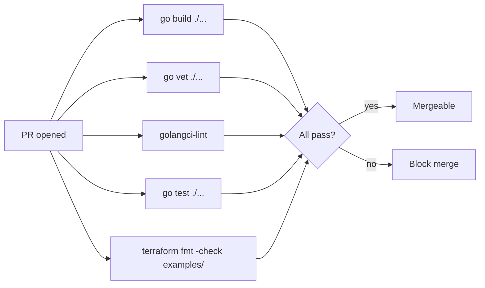
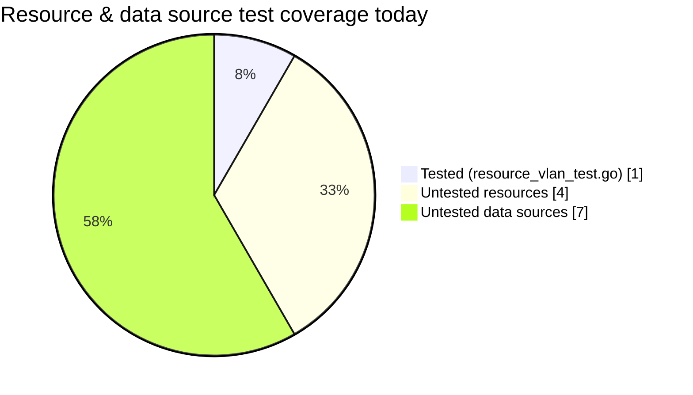
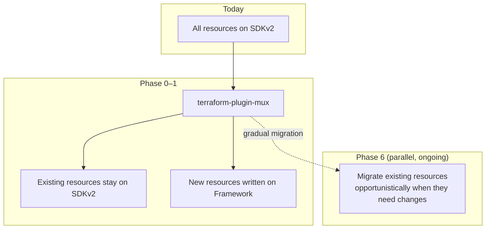

# 03 — Code Quality, Modernization & Documentation

Things that need fixing in the existing code before — or independently of — adding new resources.

---

## Severity at a glance



---

## 🔴 Blockers — fix immediately

### 1. Debug output in production data source

`hivelocity/data_source_product.go:83-84`

```go
fmt.Println("API Response:", string(body))
fmt.Fprintf(os.Stderr, "API Response: %s\n", string(body))
```

Both lines write the raw API response to stdout/stderr on every read. Remove or replace with `tflog.Debug`.

### 2. Documentation example mismatch

`docs/index.md:73-76` and `README.md:88-94` use:

```hcl
resource "hivelocity_vlan" "private_vlan" {
  device_ids = [...]
}
```

The actual schema field is `port_ids` (`resource_vlan.go`). New users will copy this and hit `Unsupported argument`. Fix both files.

### 3. Disabled-but-implemented data source

`hivelocity/provider.go:36`:

```go
// "hivelocity_ignition":             dataSourceIgnitionConfig(),
```

The implementation in `data_source_ignition_config.go` is complete (86 lines, fully functional) and an example exists at `examples/data-sources/hivelocity_ignition_config/`. Either:
- **Enable it:** uncomment the line, add `docs/data-sources/ignition_config.md`, and acceptance-test it; or
- **Delete the dead code:** remove the file, the example directory, and don't ship it.

### 4. Toolchain bump

| Component | Current | Recommended |
|---|---|---|
| Go | 1.18 (released Mar 2022) | 1.22 or 1.23 |
| terraform-plugin-sdk | v2.17.0 (Jul 2022) | v2.36+ |
| terraform-plugin-log | v0.4.0 | v0.9+ |
| oauth2 | 2021-08-19 commit | latest stable |

Sequence: bump Go first, regenerate `go.sum`, run tests, then bump SDK, regenerate again, run tests.

---

## 🟡 Warnings — fix in Phase 0 if scope allows

### Provider config inconsistency

`hivelocity/provider.go:21-27`:

```go
"api_url": {
    Type:        schema.TypeString,
    Required:    true,
    Sensitive:   false,
    DefaultFunc: schema.EnvDefaultFunc("HIVELOCITY_API_URL", "https://core.hivelocity.net/api/v2"),
},
```

`Required: true` + `DefaultFunc` is contradictory — the default makes the field effectively optional. Switch to `Optional: true`.

While here, consider adding:
- `referer` field (currently hardcoded to `"Terraform"` in `config.go`)
- request `timeout` field
- `HIVELOCITY_REFERER` env var override

### `data_source_product.go` bypasses the SDK

The product data source uses raw `net/http` rather than the generated `InventoryApi.GetInventoryProductResource()`. This is the only data source that does this. The likely reason was a JSON shape ambiguity (lines 94-112 handle two different response formats), but that's better fixed in the SDK or the API than papered over with a parallel HTTP path. Rewrite to use the SDK and report any schema issue upstream.

### `filters.go:48` — silent typo behavior

```go
// TODO: Find way to access map[string]*schema.Schema so we can validate fields
```

Today `filter { name = "produc_id" values = [...] }` (typo) silently produces zero matches. Pass the data source's schema into `buildFilters()` and error on unknown filter names. Quick win for user experience.

### Hardcoded acceptance test data

`hivelocity/resource_vlan_test.go:22` has a self-acknowledged comment:

> Test data is still hardcoded, which is not ideal - needs improvement

Refactor to env-var-driven fixtures so tests can be run against any sandbox account.

### Tainted-device retry is broken

`hivelocity/resource_bare_metal_device.go:200`:

> // Though this does not work at the moment because device statuses being inaccessible for new devices

Either fix the underlying status visibility issue or remove the dead branch. Carrying broken-but-shipped code is worse than carrying neither.

---

## 🔵 Infrastructure gaps

### No CI

`.github/` contains only `dependabot.yml`. No build/test/lint workflow.

Suggested minimal CI:



Acceptance tests (`TF_ACC=1`) need a sandbox account and shouldn't gate every PR — run them on a schedule or on opt-in label.

### Test coverage



Phase 0 should add at least one acceptance test per existing resource and data source, even if shallow (Create→Read→Destroy).

### Release automation

`.goreleaser.yml` is configured but no release workflow is wired up. Set up tag-triggered release via GitHub Actions to publish to the Terraform Registry.

---

## Recommended modernization path: Plugin Framework

The terraform-plugin-sdk v2 line is in maintenance mode. HashiCorp's recommended path for new resources is `hashicorp/terraform-plugin-framework`. The realistic migration strategy:



**Why mux instead of full migration:**
- Don't churn working resources
- New surfaces (VPS, DNS, IP, webhooks) get the modern API from the start
- Migration happens one resource at a time, on the next substantive change

**Why migrate at all:**
- Better diagnostics
- Native plan-time validation
- First-class support for nested complex types (useful for VPS)
- HashiCorp tooling is increasingly Framework-first

---

## Phase 0 checklist

- [ ] Fix `device_ids` → `port_ids` in `docs/index.md` and `README.md`
- [ ] Remove debug prints from `data_source_product.go:83-84`
- [ ] Decide and execute on `hivelocity_ignition` data source (enable or delete)
- [ ] Bump Go (1.18 → 1.22+), `terraform-plugin-sdk` (2.17 → latest), `terraform-plugin-log`
- [ ] Add `.github/workflows/ci.yml` with build, vet, lint, test, terraform-fmt
- [ ] Add `.golangci.yml` with sensible default rules
- [ ] Acceptance tests for `bare_metal_device`, `ssh_key`, `order_group`, `ignition`
- [ ] Acceptance tests for all data sources (shallow)
- [ ] Fix `filters.go:48` schema-name validation
- [ ] Rewrite `data_source_product.go` to use generated SDK
- [ ] Provider config: `api_url` Required → Optional; consider `referer`/`timeout` fields
- [ ] Decide on tainted-device retry: fix or remove
- [ ] De-hardcode `resource_vlan_test.go` fixtures
