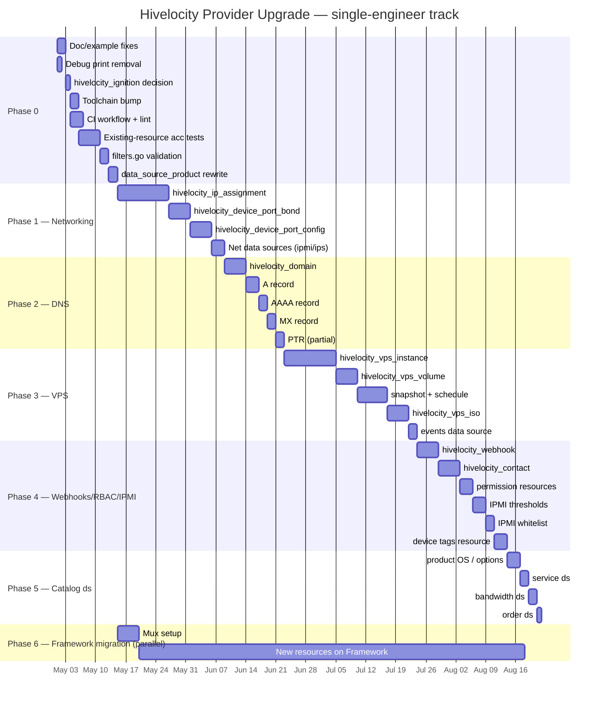
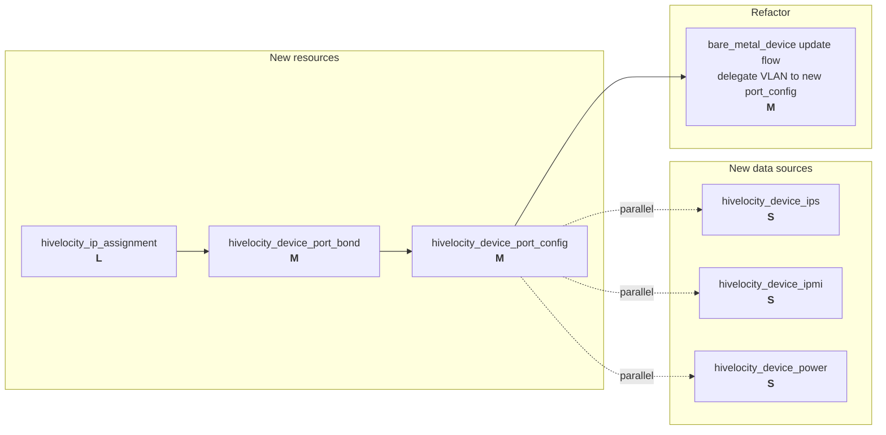
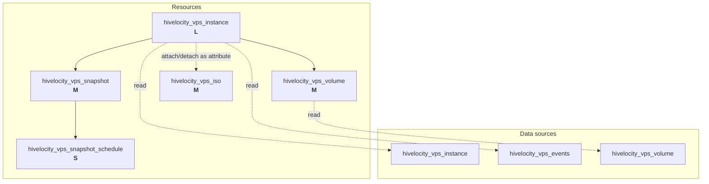
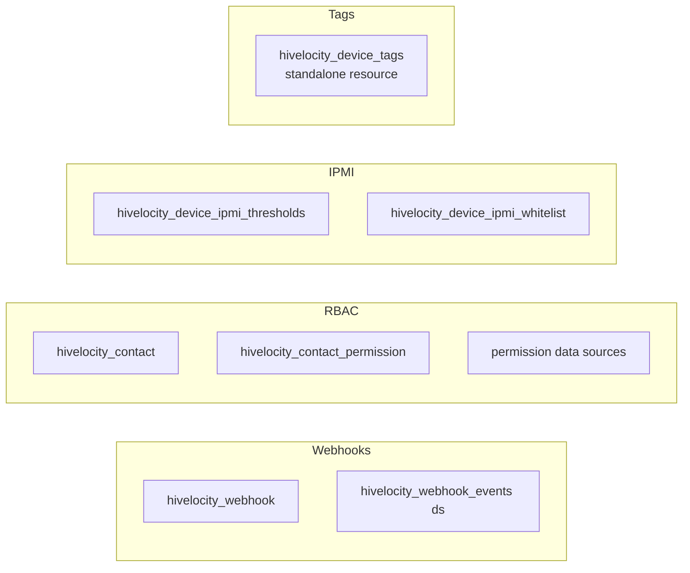
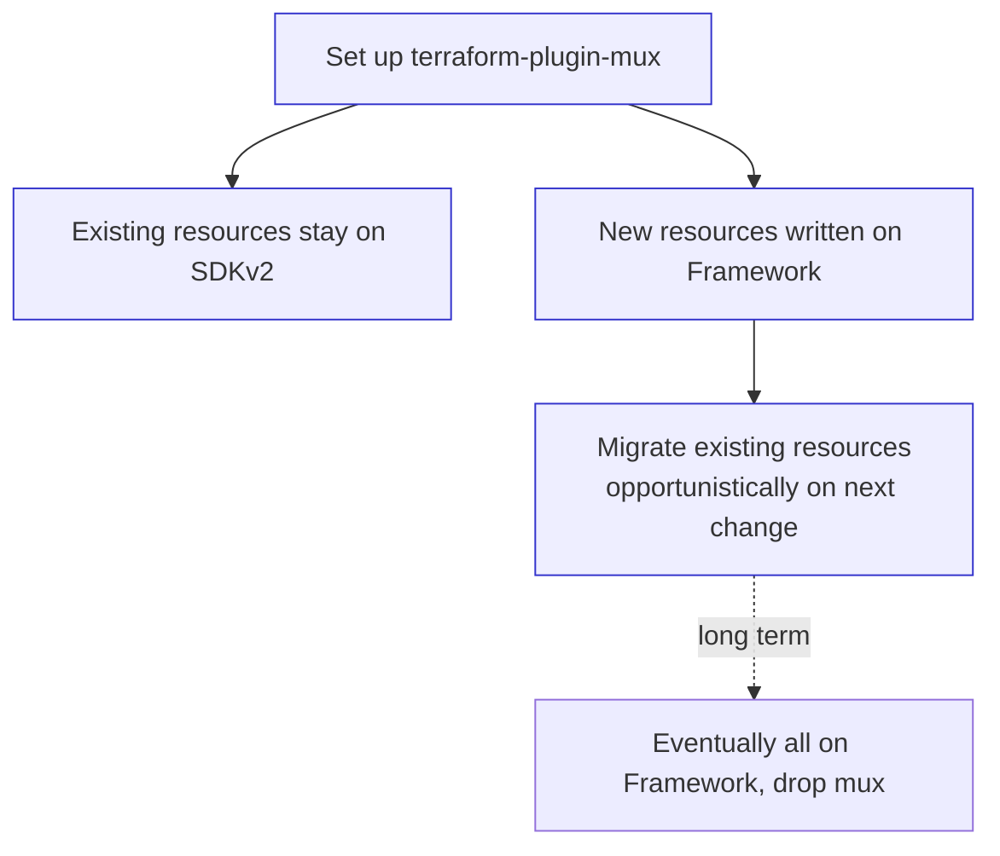

# 04 — Roadmap, Effort, Verification

Phased plan with effort sizing and dependencies.

**T-shirt sizes** (single engineer, includes schema, CRUD, docs, examples, acceptance tests):
- **S** ≈ 1–3 days
- **M** ≈ 1 week
- **L** ≈ 2–3 weeks
- **XL** ≈ 1+ month

---

## Timeline (illustrative dates)

---

## Phase 0 — Stop the bleeding (~1 week)

**Goal:** make the existing code base healthy enough to extend.

| # | Task | Size | Files |
|---|---|---|---|
| 0.1 | Fix `device_ids`→`port_ids` | S | `docs/index.md`, `README.md` |
| 0.2 | Remove debug prints | S | `hivelocity/data_source_product.go` |
| 0.3 | Decide + act on `hivelocity_ignition` ds | S | `hivelocity/provider.go`, `data_source_ignition_config.go`, docs |
| 0.4 | Toolchain bump | S | `go.mod`, `go.sum` |
| 0.5 | CI workflow | M | `.github/workflows/ci.yml`, `.golangci.yml` |
| 0.6 | Acceptance tests for existing resources | M | `*_test.go` (4 new files) |
| 0.7 | Filter name validation | S | `hivelocity/filters.go` |
| 0.8 | Rewrite product ds to use SDK | S | `hivelocity/data_source_product.go` |

**Mandatory blocker** for everything that follows.

---

## Phase 1 — Networking parity (~4–6 weeks)

**Goal:** close the user's specifically-flagged networking gap.

**Reusable patterns from existing code:**
- Async task polling: copy from `resource_vlan.go` (uses `/network/status/{taskId}`)
- Long-poll waiters: copy from `helpers_resource_device.go::waitForOrder`/`waitForDevice`
- VLAN snapshot/restore: relevant for `device_port_config` interactions

**Watch out:**
- `bare_metal_device` update flow today does VLAN snapshot/restore inline (`helpers_resource_device.go:495-568`). Once `device_port_config` exists, the inline logic should delegate to it. Consider whether to deprecate the inline behavior or leave it as a back-compat layer.

---

## Phase 2 — DNS / Domains (~3–4 weeks)

**Goal:** ship full DNS-record management.

| Resource | Endpoint | Size |
|---|---|---|
| `hivelocity_domain` | `GET/POST/DELETE /domains[/{id}]` | M |
| `hivelocity_dns_a_record` | full CRUD on `/domains/{domain}/a-record/*` | S |
| `hivelocity_dns_aaaa_record` | full CRUD | S |
| `hivelocity_dns_mx_record` | full CRUD | S |
| `hivelocity_dns_ptr_record` | `GET/PUT` only — partial | S |

**Action item:** file an upstream API request with Hivelocity for CNAME/TXT/SRV/NS support before shipping. If the API gains these record types mid-phase, ship them in the same release.

---

## Phase 3 — VPS (~6–8 weeks)

**Goal:** full VPS lifecycle as code.

**Open question** (must resolve before sizing): the swagger spec only shows `GET/PUT/DELETE /vps/{id}`. There is no POST. Verify with Hivelocity's API team whether VPS provisioning goes through `/bare-metal-devices/` shared infrastructure or has a separate POST endpoint not in the spec. This determines whether `hivelocity_vps_instance` is L (8–10 days) or XL (3+ weeks).

---

## Phase 4 — Webhooks, RBAC, IPMI, Tags (~3–4 weeks)

| Item | Size |
|---|---|
| `hivelocity_webhook` + `hivelocity_webhook_events` | M |
| `hivelocity_contact` resource + data source | M |
| `hivelocity_contact_permission` + permission data sources | M |
| `hivelocity_device_tags` standalone resource | S |
| `hivelocity_device_ipmi_thresholds`, `hivelocity_device_ipmi_whitelist` | M |

---

## Phase 5 — Catalog & telemetry data sources (~1–2 weeks)

Pure data sources — small, parallelizable.

| Item | Endpoint(s) | Size |
|---|---|---|
| `hivelocity_product_operating_systems` | `GET /product/{id}/operating-systems` | S — **high user value** |
| `hivelocity_product_options` | `GET /product/{id}/options`, `GET /product/options` | S |
| `hivelocity_inventory_product` | `GET /inventory/product/{id}` | S |
| `hivelocity_service`, `_services`, `_service_types`, `_device_services` | `/service/*` | S |
| `hivelocity_bandwidth_device`, `_bandwidth_service` | `POST /bandwidth/{device,service}/{id}` | S |
| `hivelocity_order`, `_orders` | `GET /order[/{id}]` | S |
| `hivelocity_device_power`, `_device_ips` | `GET /device/{id}/{power,ips}` | S (could fold into Phase 1) |

---

## Phase 6 — Plugin Framework migration (parallel)

Not blocking. Can start as early as Phase 0 (set up mux) and runs alongside everything else.

---

## Total effort summary

| Phase | Range | Cumulative |
|---|---|---|
| 0 | ~1 week | 1 week |
| 1 | 4–6 weeks | 5–7 weeks |
| 2 | 3–4 weeks | 8–11 weeks |
| 3 | 6–8 weeks | 14–19 weeks |
| 4 | 3–4 weeks | 17–23 weeks |
| 5 | 1–2 weeks | 18–25 weeks |
| 6 | parallel | n/a |

**~5–6 months single-engineer.** With two engineers in parallel after Phase 0 (one on networking/DNS, one on VPS), total wall-clock can come down to ~3–4 months.

---

## Verification

For each phase:

1. **Compile + vet:** `go build ./...`, `go vet ./...`, `golangci-lint run`
2. **Unit tests:** `go test ./hivelocity/...` — covers `filters.go`, `helpers_datasources.go`
3. **Acceptance tests:** `TF_ACC=1 HIVELOCITY_API_KEY=… make testacc` against a sandbox account
   - Each new resource: at least one Create→Read→Update→Delete test and one import test
4. **Manual smoke:** `terraform init && terraform plan && terraform apply && terraform destroy` end-to-end before tagging a release
5. **Docs sanity:** run `terraform-plugin-docs` after every schema change; commit the regenerated `/docs`
6. **Cross-check vs. spec:** after each phase, diff the implemented resource list against [`02-gap-analysis.md`](./02-gap-analysis.md) and update
7. **Release verification:** tag a pre-release, install from a local mirror, run a real Terraform configuration against staging, then publish to the registry

---

## Critical files

**Will change in Phase 0:**
- `hivelocity/provider.go` — register new items, fix `hivelocity_ignition` decision
- `hivelocity/config.go` — provider option fixes
- `hivelocity/data_source_product.go` — remove debug, switch to SDK
- `hivelocity/filters.go` — schema-name validation (line 48)
- `docs/index.md`, `README.md` — VLAN example fix
- `go.mod`, `go.sum` — toolchain bump
- `.github/workflows/*` — new files

**Pattern templates for new resources:**
- `hivelocity/resource_ssh_key.go` — simplest CRUD, copy as template
- `hivelocity/resource_vlan.go` — async task-polling pattern (copy for IP routing, port config)
- `hivelocity/resource_bare_metal_device.go` + `helpers_resource_device.go` — long-poll provisioning (copy for VPS create)
- `hivelocity/resource_ignition_config.go` — JSON-content state normalization (copy for any user-supplied JSON)

**Reusable utilities (don't duplicate):**
- `helpers_datasources.go::convertKeys`, `forceValuesToStrings`, `normalizeJsonString`, `filterNonSchemaKeys`
- `filters.go::doFiltering`, `dataSourceFiltersSchema`
- `helpers_resource_device.go::formatSwaggerError` — wrap every API call

**Spec source of truth:**
- `swagger.json` — 170 KB, OpenAPI 2.0. The local `hivelocity-client-go` SDK is generated from this. Any drift must be reconciled.

---

## Open questions

1. **`/deploy/*` vs `/bare-metal-devices`** — is `/deploy/*` still primary or fully superseded? Affects whether Phase 1 needs a `hivelocity_deployment` resource.
2. **VPS create flow** — the spec only shows `GET/PUT/DELETE /vps/{id}`. Where does provisioning POST live? Confirm before sizing Phase 3.
3. **DNS record-type gap** — will Hivelocity add CNAME/TXT/SRV/NS to the API? Affects whether Phase 2 ships in one stage or two.
4. **Plugin Framework migration appetite** — comfortable with `terraform-plugin-mux` + gradual migration, or stay fully on SDKv2 for now?
5. **CI sandbox account** — billable-but-bounded test account suitable for `TF_ACC=1` in CI? Without one, acceptance tests can only run locally.
6. **Tainted-device retry (`resource_bare_metal_device.go:200`)** — fix or remove? Need to know whether the underlying status visibility issue is in scope.
7. **PTR records & IPMI whitelist DELETE** — confirm intentional API gaps with Hivelocity team.
